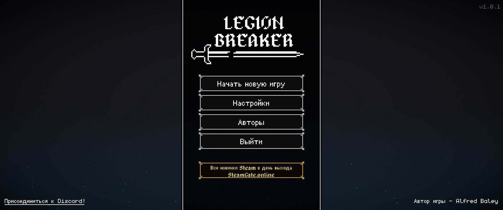
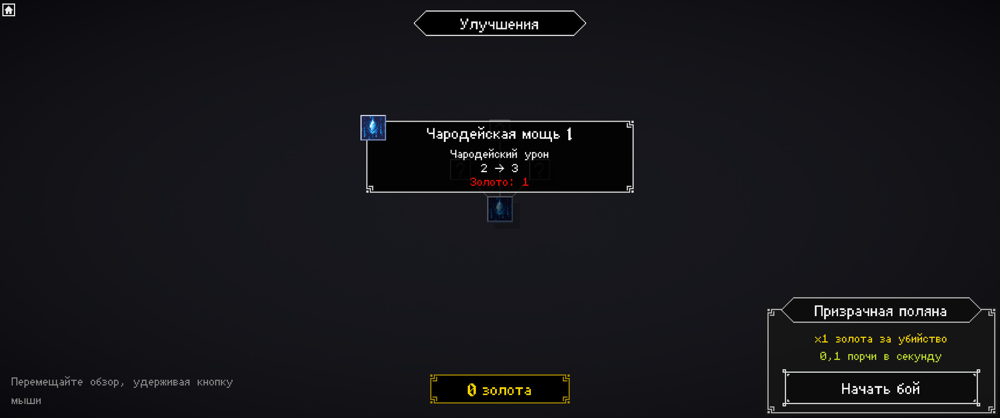
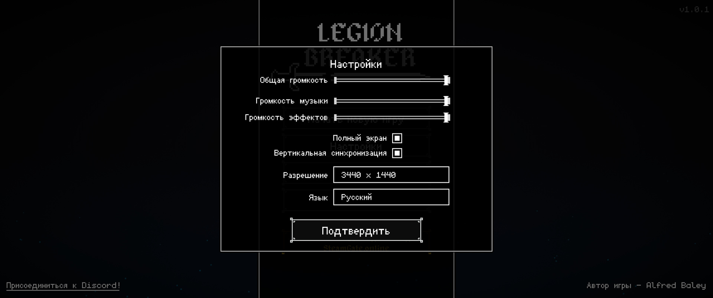
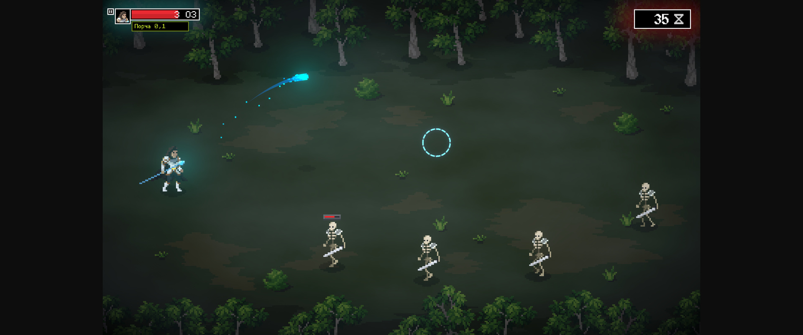

# Русификатор Legion Breaker

**[Скачать русификатор](https://github.com/sincess1/legion-breaker-rusifikator/releases/latest)**

Версия перевода **1.0.0** · игра **1.0.1** · Steam Build **25985081** · Windows 64 бит.

Сделан командой [SteamGate.online](https://steamgate.online/ru?utm_source=github&utm_medium=readme&utm_campaign=legion-breaker) — все новинки Steam в день выхода.

[Зеркало и инструкция на SteamGate](https://steamgate.online/ru/blog/legion-breaker-rusifikator).

[Руководство Steam](https://steamcommunity.com/sharedfiles/filedetails/?id=3820941141) · [Страница PlayGround](https://www.playground.ru/misc/file/legion_breaker_rusifikator_russkij_yazyk_1_0_0-1882305)

## Что переведено

Все 489 записей пяти таблиц локализации: меню и настройки, улучшения и описания, характеристики заклинаний и войск, 12 полей боя, сюжетные выборы и сообщения. Дополнительно переведены отдельные надписи, сокращения времени и чисел. Имена авторов и названия сторонних проектов сохранены.

Связанные улучшения используют единые названия. Подстановки, теги, переносы и ступени улучшений проверены отдельно. Кириллица использует шрифты самой игры; озвучка и изображения не меняются.

## Установка

1. Закройте игру. В Steam нажмите на Legion Breaker правой кнопкой → «Управление» → «Просмотреть локальные файлы».
2. Распакуйте содержимое ZIP в открытую папку рядом с `Legion Breaker.exe` и запустите игру.

Русский включится автоматически. Выбрать язык вручную можно в «Настройки» → «Язык» → «Русский». Выбор сохраняется.

В архиве уже есть BepInEx 5.4.23.5 x64, DLL-плагин, инструкция и лицензии. Отдельного установщика нет. Оригинальные файлы игры не заменяются. Если BepInEx уже установлен для других модов, сохраните его и добавьте только `BepInEx/plugins/LegionRussian`.

Перед установкой сохраните копию `%USERPROFILE%\AppData\LocalLow\Baffled Engineer\Legion Breaker`. Другие русификаторы этой игры предварительно удалите.

## Удаление

Закройте игру и удалите `BepInEx/plugins/LegionRussian`. Если загрузчик установлен только для этого перевода, дополнительно удалите `BepInEx`, `winhttp.dll` и `doorstop_config.ini`. Если используете другие моды, сохраняйте их загрузчик и папки. Сохранения удалять не требуется.

## Вопросы

**Русский не появился.** Проверьте, что `BepInEx`, `winhttp.dll` и `doorstop_config.ini` лежат рядом с `Legion Breaker.exe`, затем выберите «Русский» в настройках. Для обращения об ошибке приложите снимок экрана, версию игры и `BepInEx/LogOutput.log`.

**Игра обновилась.** Перевод проверен на указанной сборке. Измененные разработчиком строки остаются на английском до обновления перевода. Совместимость загрузчика и интерфейса с будущими версиями не гарантируется. Новые выпуски находятся на странице релизов.

**Почему в меню есть SteamGate?** Русификатор бесплатный. В главном меню и паузе добавлена отдельная ссылка на SteamGate, открывающаяся только по нажатию. Кнопки и титры разработчика сохранены.

**Steam Deck, Linux и macOS.** Не проверялись. Этот архив рассчитан на Windows.

**Windows сообщает об опасности.** Не отключайте защиту. Скачайте архив из раздела Releases этого репозитория и сравните его SHA-256 с опубликованным значением.

## Для поиска

Legion Breaker русификатор, Legion Breaker на русском, русский язык Legion Breaker, перевод Legion Breaker, скачать русификатор Legion Breaker, Legion Breaker Russian translation, Legion Breaker Russian localization.

This unofficial mod adds Russian text to Legion Breaker. Tested target: Windows 64-bit, game 1.0.1, Steam Build 25985081. Download the ZIP from Releases and extract it beside the game executable. Original game files are preserved. Voice-over is unchanged.
